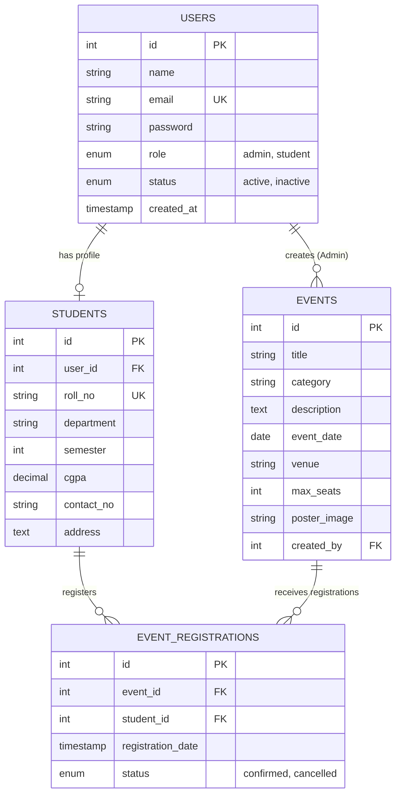

# Practical 8: Relational Database Schema Design and PHP-MySQL Connectivity

## Aim
To design a normalized relational database schema (`studenthub`) using MySQL, establish database connectivity in PHP using `mysqli`, and verify table structures, foreign key constraints, and seed data via an interactive diagnostic script.

---

## Entity-Relationship (ER) Diagram



---

## Data Dictionary

### 1. `users` Table
| Column Name | Data Type | Constraints | Description |
| :--- | :--- | :--- | :--- |
| `id` | `INT` | PRIMARY KEY, AUTO_INCREMENT | Unique identifier for each user account |
| `name` | `VARCHAR(100)` | NOT NULL | Full name of the user |
| `email` | `VARCHAR(100)` | NOT NULL, UNIQUE | University email address (used for login) |
| `password` | `VARCHAR(255)` | NOT NULL | Securely hashed password (Bcrypt) |
| `role` | `ENUM('admin', 'student')` | DEFAULT 'student' | Role-based authorization type |
| `status` | `ENUM('active', 'inactive')`| DEFAULT 'active' | Account status flag |
| `created_at` | `TIMESTAMP` | DEFAULT CURRENT_TIMESTAMP | Account registration timestamp |

### 2. `students` Table
| Column Name | Data Type | Constraints | Description |
| :--- | :--- | :--- | :--- |
| `id` | `INT` | PRIMARY KEY, AUTO_INCREMENT | Student profile ID |
| `user_id` | `INT` | FOREIGN KEY (`users.id`) ON DELETE CASCADE | Associated user account |
| `roll_no` | `VARCHAR(20)` | NOT NULL, UNIQUE | College enrollment / roll number |
| `department` | `VARCHAR(50)` | NOT NULL | Branch / Department |
| `semester` | `INT` | NOT NULL, DEFAULT 1 | Current semester number |
| `cgpa` | `DECIMAL(3,2)` | DEFAULT 0.00 | Academic CGPA |
| `contact_no` | `VARCHAR(15)` | NOT NULL | Mobile number |
| `address` | `TEXT` | NULL | Residential address |

### 3. `events` Table
| Column Name | Data Type | Constraints | Description |
| :--- | :--- | :--- | :--- |
| `id` | `INT` | PRIMARY KEY, AUTO_INCREMENT | Event record ID |
| `title` | `VARCHAR(150)` | NOT NULL | Event name |
| `category` | `VARCHAR(50)` | NOT NULL | Category (Technical, Cultural, Workshop, Sports) |
| `description` | `TEXT` | NOT NULL | Full event description |
| `event_date` | `DATE` | NOT NULL | Scheduled event date |
| `venue` | `VARCHAR(100)` | NOT NULL | Venue / Lab / Auditorium |
| `max_seats` | `INT` | NOT NULL, DEFAULT 50 | Total maximum seating capacity |
| `poster_image`| `VARCHAR(255)` | DEFAULT 'default_event.jpg' | Uploaded banner filename |
| `created_by` | `INT` | FOREIGN KEY (`users.id`) ON DELETE SET NULL | Admin user ID who created event |

### 4. `event_registrations` Table
| Column Name | Data Type | Constraints | Description |
| :--- | :--- | :--- | :--- |
| `id` | `INT` | PRIMARY KEY, AUTO_INCREMENT | Registration ID |
| `event_id` | `INT` | FOREIGN KEY (`events.id`) ON DELETE CASCADE | Event foreign key |
| `student_id` | `INT` | FOREIGN KEY (`students.id`) ON DELETE CASCADE | Student profile foreign key |
| `status` | `ENUM('confirmed', 'cancelled')` | DEFAULT 'confirmed' | Registration state |

---

## Setup & Execution Steps
1. **Import Database Schema:**
   - Open **phpMyAdmin** (`http://localhost/phpmyadmin`).
   - Create a new database named `studenthub` (or import directly).
   - Click the **Import** tab, choose `schema.sql`, and click **Go**.
   - *Alternatively, via terminal:*
     ```bash
     /Applications/XAMPP/xamppfiles/bin/mysql -u root -p < schema.sql
     ```
2. **Verify Connectivity:**
   - Open `test_db.php` in your browser:
     `http://localhost/wdf/Practical-08-MySQL-Schema-Connection/test_db.php`
   - You should see the green status banner and row counts for all four tables.

---

## Viva Questions & Answers

### Q1: Compare `mysqli` and `PDO`. Which one is preferred in enterprise projects?
- **`mysqli` (MySQL Improved):**
  - Works **only** with MySQL databases.
  - Supports both procedural and object-oriented syntax.
  - Slightly faster for MySQL-specific applications.
- **`PDO` (PHP Data Objects):**
  - Database-agnostic: supports 12+ different database drivers (MySQL, PostgreSQL, SQLite, Oracle, SQL Server).
  - Uses a uniform API across all database engines.
  - If a company switches from MySQL to PostgreSQL, PDO requires changing only the DSN connection string rather than rewriting queries.
- **Verdict:** PDO is preferred in enterprise multi-database architectures, while `mysqli` is widely taught for beginner simplicity with MySQL.

### Q2: What is the purpose of Foreign Key Constraints and `ON DELETE CASCADE`?
- **Foreign Key:** Enforces **referential integrity** between two related tables. It ensures that a child row cannot reference a nonexistent parent row.
- **`ON DELETE CASCADE`:** Automatically deletes all related child rows when the parent row is deleted. For example, if a user account is deleted in `users`, their corresponding record in `students` and their registrations in `event_registrations` are automatically deleted, avoiding orphan records.
- **`ON DELETE SET NULL`:** Sets the child foreign key column to `NULL` instead of deleting the child record (used in `events.created_by` so events remain even if the admin account is deleted).

### Q3: What is SQL Injection and how do Prepared Statements prevent it?
- **SQL Injection (SQLi):** An attack where malicious SQL fragments are injected into application input fields (e.g. entering `' OR '1'='1` in a login field).
- **Prepared Statements Prevention:**
  - Prepared statements separate the **SQL query logic (template)** from the **user data parameters**.
  - The query template is compiled on the database server first (`PREPARE`).
  - User parameters are transmitted separately (`BIND PARAM`) as raw data literals. Even if input contains SQL syntax, it is treated purely as string data, never as executable code.

### Q4: Why should database configuration constants be kept in a centralized file like `db.php`?
- **Single Source of Truth:** Changing the database credentials (e.g., migrating from `localhost` to a production host) only requires editing one file rather than dozens of scripts.
- **Security:** Simplifies excluding credentials from public Git repositories (via `.gitignore` and environment variables).

### Q5: Why is `utf8mb4` character set used instead of standard `utf8` in MySQL?
- MySQL's older `utf8` charset only supports up to 3 bytes per character, which fails on 4-byte Unicode characters (including emojis, special symbols, and certain international scripts).
- `utf8mb4` provides full 4-byte Unicode support, preventing data corruption or SQL errors when users input emojis or multilingual text.
