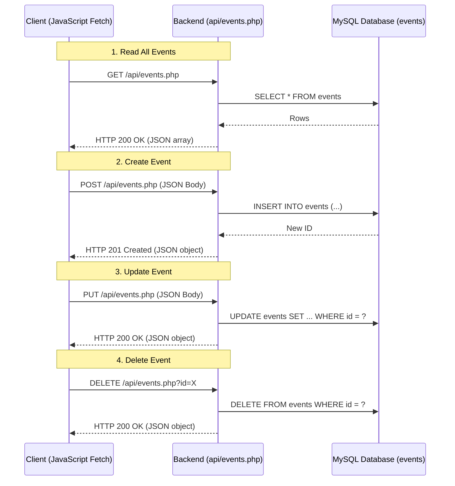

# Practical 13: Asynchronous CRUD Operations using PHP REST-like JSON API & JavaScript Fetch API

## Aim
To architect and implement a Single Page Application (SPA) module for campus events using a lightweight PHP RESTful JSON API backend (`api/events.php`) and client-side JavaScript `fetch()` API calls, executing full CRUD (Create, Read, Update, Delete) without any page reloads.

---

## REST API Architecture & HTTP Verbs

---

## File Summary
- `api/events.php`: RESTful endpoint handling `GET`, `POST`, `PUT`, `DELETE` methods, parsing JSON inputs via `php://input`, and returning structured JSON payloads with standard HTTP status codes.
- `index.html`: Modern Single Page Application (SPA) interface containing an event grid, live search bar, modal dialog, and non-blocking toast notifications.
- `js/app.js`: Asynchronous frontend controller managing API requests, DOM manipulation, modal states, and error handling.
- `db.php`: Database connection helper with JSON error output.
- `css/style.css`: Clean, beginner stylesheet.

---

## Viva Questions & Answers

### Q1: What is a RESTful API and how do HTTP Verbs correspond to CRUD operations?
- **REST (Representational State Transfer):** An architectural style for networked applications that utilizes standard HTTP methods to manipulate resources represented in formats like JSON or XML.
- **Mapping:**
  - `GET`: Read / retrieve resources.
  - `POST`: Create a new resource.
  - `PUT`: Update / replace an existing resource.
  - `DELETE`: Remove an existing resource.

### Q2: Why is `header('Content-Type: application/json; charset=UTF-8')` necessary?
- It informs the receiving browser or client that the payload is formatted as JSON. The client knows not to render it as raw HTML, and client-side tools like `response.json()` can parse the body into native objects cleanly.

### Q3: Why is `$_POST` empty when sending JSON data from `fetch()`, and how does `php://input` solve it?
- PHP's `$_POST` superglobal is only designed to parse data sent with Content-Type `application/x-www-form-urlencoded` or `multipart/form-data`.
- When JavaScript sends a request with `Content-Type: application/json`, PHP does not automatically parse the raw request body into `$_POST`.
- `file_get_contents('php://input')` reads the raw, unparsed HTTP request body stream directly, which can then be parsed into a PHP associative array using `json_decode($json, true)`.

### Q4: Explain standard HTTP Response Status Codes used in APIs.
- `200 OK`: Standard success response for successful GET, PUT, or DELETE operations.
- `201 Created`: The request succeeded and a new resource was created (used for POST).
- `400 Bad Request`: The request could not be processed due to client error (missing required parameters or invalid syntax).
- `404 Not Found`: The requested resource or record does not exist.
- `405 Method Not Allowed`: The HTTP method sent is not supported by the endpoint.
- `500 Internal Server Error`: An unexpected failure occurred on the server (e.g. database query failure).

### Q5: What are the advantages of a Single Page Application (SPA) using Fetch API over traditional multi-page forms?
1. **No Jarring Page Refreshes:** Only the changed components of the page are updated, preserving user scroll position and form state.
2. **Speed & Bandwidth Efficiency:** Only raw data (a few kilobytes of JSON) travels over the network instead of re-downloading whole HTML pages, CSS, and images on every click.
3. **Better Mobile Experience:** Instantaneous UI feedback with animated transitions and toast alerts creates a native app-like user experience.
